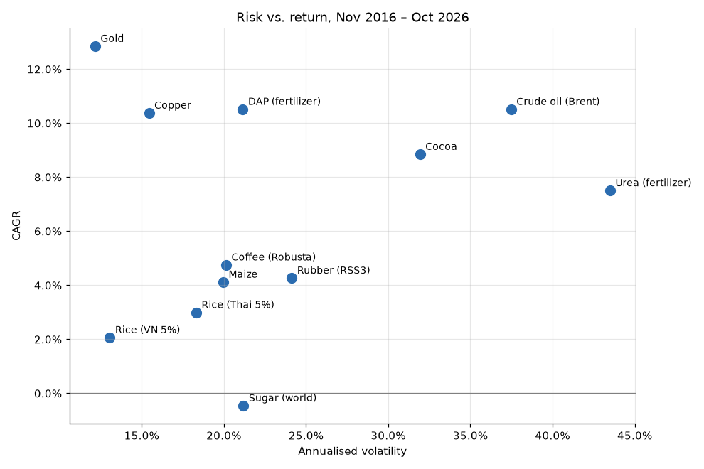
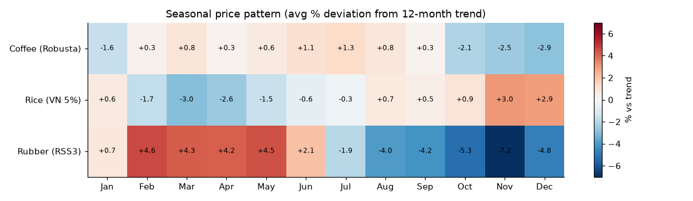
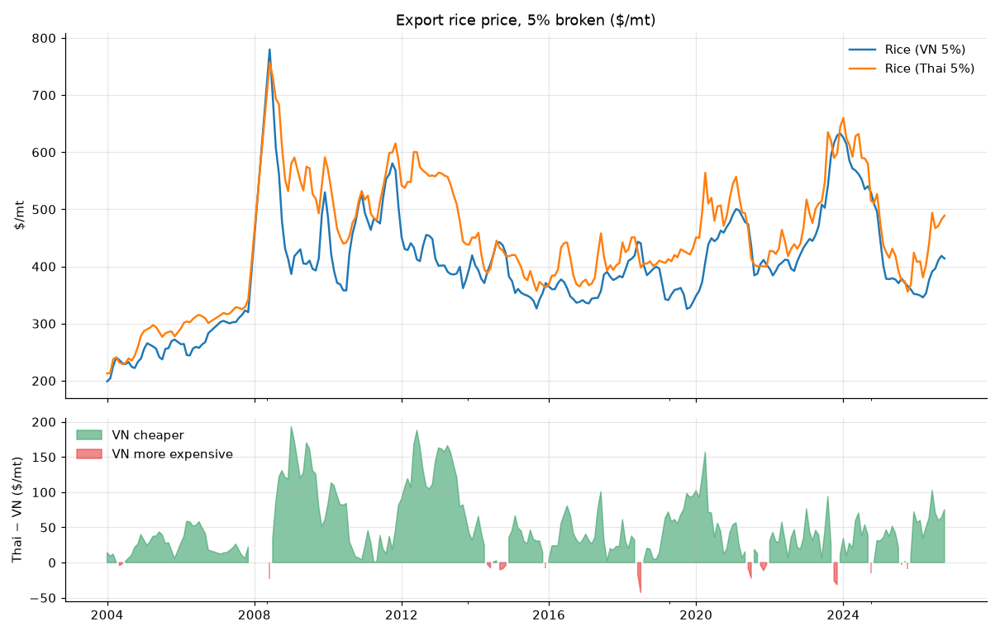

# 📈 Vietnam Commodity Price Analysis

> How world prices of Viet Nam's key exports (rice, Robusta coffee, rubber) and imported inputs
> (oil, fertilizer) behaved from 2004 to **October 2026**, and what that means for farmers,
> exporters and planners.

**Tools:** Python · pandas · matplotlib · Plotly · Streamlit · Jupyter
**Skills shown:** data cleaning · KPI design · time-series analysis (growth, volatility, drawdown,
seasonality, lagged correlation) · data visualization · interactive dashboard · business recommendations



---

## Business questions

| # | Question | Method |
|---|---|---|
| 1 | Which commodities rose or fell the most? | YoY %, 10-year CAGR, price vs. 10-yr average |
| 2 | Which are riskiest for the return they give? | Annualised volatility, max drawdown, risk–return plot |
| 3 | Are there seasonal patterns to plan sales around? | Deviation from 12-month moving average by month |
| 4 | How competitive is Vietnamese rice vs. Thai rice? | Price spread (Thai 5% − VN 5%) |
| 5 | Do oil and fertilizer costs feed into rice prices? | Correlation & lagged correlation of monthly % changes |
| 6 | How fast do world rice prices reach Mekong Delta markets? | Domestic wholesale vs. export price, pass-through lag |

## Key findings (data to Oct 2026)

1. **2026 rally led by energy and metals:** Brent crude **+93% YoY** to $125/bbl, rubber **+42%**,
   copper **+35%** to a record high.
2. **Gold was the best risk-adjusted asset of the decade:** ~13%/yr growth with the lowest volatility (12%).
3. **Coffee is cooling:** **−23% YoY** after its Feb 2025 peak ($5.8/kg), but still ~35% above its
   10-year average.
4. **Vietnamese rice = low risk, low return:** the most stable series (13% volatility), ~2%/yr growth.
5. **Rice competitiveness:** VN rice was cheaper than Thai rice in **92% of months** (avg. ≈ $48/mt);
   the gap widened to ~$75/mt by Oct 2026.
6. **Seasonality:** rubber is +4–5% above trend in Feb–May and −5–7% in Oct–Nov; coffee is weakest in
   Oct–Dec (VN harvest); rice dips in Mar–Apr (winter-spring harvest).
7. **Cost squeeze on farmers:** oil moves reach urea within ~1 month, but urea moves do **not** pass into
   export rice prices.
8. **Fast pass-through:** world rice price changes hit Mekong wholesale prices in the **same month**
   (corr. 0.79), with a smaller follow-through the next month (0.54); domestic wholesale ≈ **88%** of
   the export price.

| Seasonality | VN vs Thai rice |
|---|---|
|  |  |

➡️ Full analysis, charts and recommendations: [`notebooks/analysis.ipynb`](notebooks/analysis.ipynb)

## Interactive dashboard

Filter commodities and periods. Four tabs: trends, risk & return, seasonality, rice deep-dive.

```bash
streamlit run app.py
```

<!-- Add a screenshot of the dashboard here: images/dashboard.png -->

## Project structure

```
├── app.py                    # Streamlit dashboard
├── data/
│   ├── raw/                  # original files (World Bank, WFP)
│   └── processed/            # tidy CSVs produced by clean.py
├── images/                   # charts exported by the notebook
├── notebooks/analysis.ipynb  # the analysis & storytelling
└── src/
    ├── download.py           # fetch the latest raw data
    ├── clean.py              # raw -> tidy data
    ├── metrics.py            # KPI functions shared by notebook & dashboard
    └── build_notebook.py     # generates the notebook (reproducible)
```

## Run it yourself

```bash
python -m venv .venv
.venv\Scripts\activate          # macOS/Linux: source .venv/bin/activate
pip install -r requirements-dev.txt   # dashboard only: requirements.txt

python src/download.py          # optional: refresh to the latest month
python src/clean.py
python src/build_notebook.py
jupyter nbconvert --to notebook --execute --inplace notebooks/analysis.ipynb
streamlit run app.py
```

## Data sources

- **World Bank Commodity Price Data (The Pink Sheet)**: monthly prices, nominal USD, 1960 – Oct 2026.
  <https://www.worldbank.org/en/research/commodity-markets>
- **WFP Viet Nam Food Prices**: wholesale rice in An Giang, Dong Thap and Bac Lieu, 2008 – Jun 2022.
  <https://data.humdata.org/dataset/wfp-food-prices-for-viet-nam>

## Limitations & next steps

- Prices are nominal USD; next step: deflate by CPI and convert to VND.
- Domestic data covers only 3 Mekong markets and ends in 2022.
- Correlation is not causation; next step: simple forecasting (SARIMA / Prophet) for rice and coffee.
